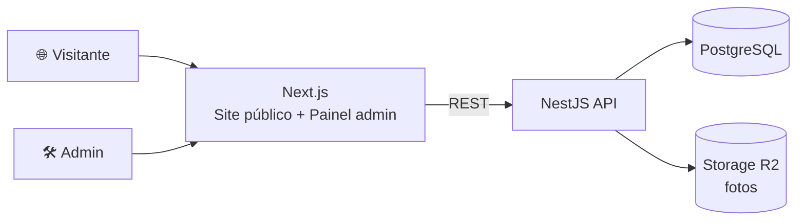

<div align="center">

# ⛪ Sistema Paroquial

**Site institucional e painel de gestão para a paróquia**


[Sobre](#-sobre-o-projeto) · [Funcionalidades](#-funcionalidades) · [Tecnologias](#-tecnologias) · [Documentação](#-documentação) · [Roadmap](#-fases-do-projeto)

</div>

---

## 📖 Sobre o projeto

O **Sistema Paroquial** reúne em um só lugar tudo o que a comunidade precisa saber sobre a paróquia e o que a equipe precisa para organizá-la. Ele é composto por duas frentes integradas:

| Frente | Público | Objetivo |
|---|---|---|
| 🌐 **Site Institucional** | Comunidade e visitantes | Informar sobre programação, eventos, sacramentos, pastorais, galeria e contato |
| 🛠️ **Painel Administrativo** | Equipe da paróquia | Alimentar o site e gerenciar missas, eventos e escalas, sem depender de desenvolvedores |

---

## ✨ Funcionalidades

### 🌐 Site público

- 🏠 **Home** com destaques: próximos eventos, comunicados recentes e horários de missa
- 📢 **Comunicados** (notícias exclusivas da paróquia)
- 📅 **Calendário** mensal da programação
- 🎉 **Eventos** passados e futuros, com página de detalhe e **"Garantir Presença"** (sem login)
- ✝️ **Sacramentos** com explicações, documentos necessários e FAQ
- 🙌 **Pastorais** e seus grupos de atuação
- 📸 **Galeria** organizada por álbuns
- ℹ️ **Sobre Nós** e **Contatos**

### 🛠️ Painel admin

- 🔐 Login e **controle de acesso por cargo** (Admin Geral, Secretaria, Coordenador de Pastoral)
- ⛪ Gestão de **Missas** (incluindo recorrentes) e **Eventos**
- 📋 **Escalas** de voluntários com relatórios e escopo por pastoral
- 🧑‍🤝‍🧑 Cadastro de **Voluntários**
- ✍️ CRUD de comunicados, sacramentos, pastorais e galeria
- 🕵️ **Auditoria** de ações críticas

### 👤 Perfis de acesso

| Cargo | Acesso |
|---|---|
| 🔑 **Admin Geral** | Total |
| 🗂️ **Secretaria** | Comunicados, eventos, missas, calendário, sacramentos e galeria |
| 🙏 **Coordenador de Pastoral** | Conteúdo e escalas da própria pastoral |

---

## 🧰 Tecnologias

| Camada | Tecnologia |
|---|---|
| Front-end | Next.js · TypeScript |
| Back-end | NestJS · API REST · JWT |
| Banco de dados | PostgreSQL |
| ORM / Migrations | Prisma |
| Armazenamento de imagens | Cloudflare R2 |

---

## 🏗️ Arquitetura



---

## 📁 Estrutura do repositório

```
.
├── documents/     # 📚 Requisitos, regras, casos de uso, modelagem
├── frontend/      # 🎨 Next.js (site público + admin)
├── backend/       # ⚙️ NestJS + Prisma
└── README.md
```

---

## 📚 Documentação

Toda a documentação de projeto está em [`documents/`](./documents/README.md):

| Documento | Descrição |
|---|---|
| [📋 Requisitos Funcionais](./documents/requisitos/requisitos-funcionais.md) | 24 requisitos (RF) |
| [⚙️ Requisitos Não Funcionais](./documents/requisitos/requisitos-nao-funcionais.md) | 20 requisitos (RNF) |
| [📐 Regras de Negócio](./documents/requisitos/regras-de-negocio.md) | 17 regras (RN) |
| [🎭 Casos de Uso](./documents/casos-de-uso/casos-de-uso.md) | 37 casos de uso (UC) |
| [🗄️ Modelagem de Dados](./documents/modelagem/modelagem-de-dados.md) | Diagrama ER e convenções |

---

## 🚀 Como executar

> ⚠️ Preencha os comandos conforme os `package.json` de cada projeto.

### Pré-requisitos

- Node.js (versão LTS)
- PostgreSQL
- Gerenciador de pacotes (npm/yarn/pnpm)

### Back-end

```bash
cd backend
cp .env.example .env        # configure DATABASE_URL, JWT_SECRET, etc.
npm install
npx prisma migrate dev
npm run start:dev
```

### Front-end

```bash
cd frontend
cp .env.example .env.local  # configure a URL da API
npm install
npm run dev
```

---

## 🗺️ Fases do projeto

| Fase | Escopo | Status |
|:---:|---|:---:|
| **MVP** | Site público, painel admin, missas, eventos, escalas, comunicados, galeria, sacramentos, pastorais | 🚧 Em andamento |
| **2** | Doações e campanhas de arrecadação | ⏳ Planejada |
| **3** | A definir (ex.: 2FA no login do admin) | ⏳ Planejada |
| **4** | Área de acesso do fiel/paroquiano | ⏳ Planejada |

---

## 🔒 Segurança e LGPD

- Senhas com hash forte (bcrypt/argon2)
- Validação e sanitização de entradas; validação de uploads no back-end
- Rate limiting em endpoints públicos
- Coleta mínima de dados pessoais e possibilidade de exclusão
- Segredos somente via variáveis de ambiente

---

## 👨‍💻 Autor

Desenvolvido por **hchepli**.

---

<div align="center">

Feito com ❤️ para a comunidade paroquial

</div>
