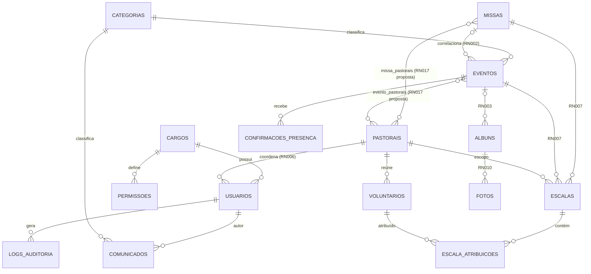

# 🗄️ Modelagem de Dados

> Banco real: **PostgreSQL via Prisma** (`schema.prisma` no repositório do back-end).
> O arquivo [`schema_modelagem_mysql.sql`](./schema_modelagem_mysql.sql) é apenas referência para visualização no MySQL Workbench (EER).

## Diagrama (Entidade-Relacionamento)

## Convenções

| Tipo de tabela | ID |
|---|---|
| Sensíveis / não enumeráveis (`usuarios`, `escalas`, `confirmacoes_presenca`, `logs_auditoria`) | UUID |
| Conteúdo simples | Inteiro autoincrement |

## Regras validadas no SERVICE (não no banco)

| Regra | Descrição |
|---|---|
| RN007 | Escala vinculada a Missa **XOR** Evento |
| RN010 | Capa única por Álbum |
| RN017 *(proposta)* | `escalas.pastoral_id` deve estar entre as Pastorais vinculadas à Missa/Evento |

## Fora do MVP (sem tabelas ainda)

- `doacoes`, `campanhas_arrecadacao` (Fase 2)
- Área do fiel/paroquiano (Fase 4)
